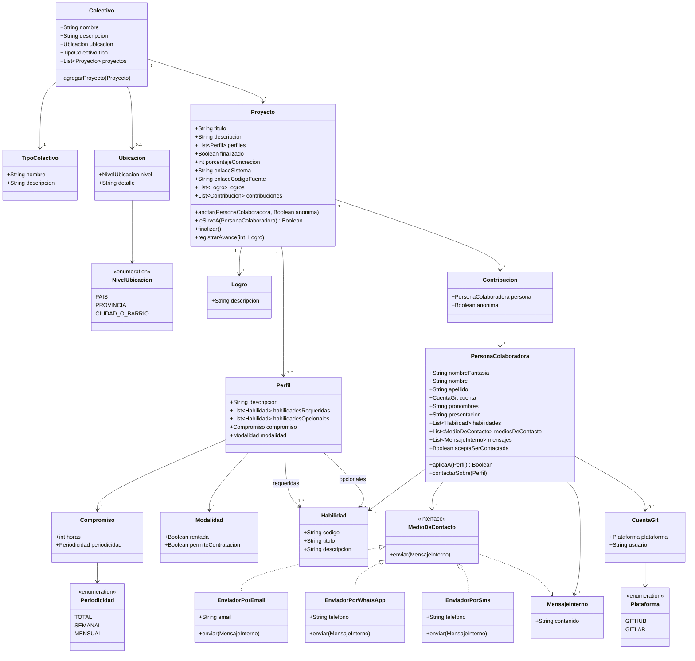

# Código a Voluntad — Diagrama de clases del dominio



## Comportamiento principal

`PersonaColaboradora.aplicaA(perfil)`

```
aplicaA(perfil):
    return perfil.habilidadesRequeridas.todas(h => this.habilidades.contiene(h))
```

`PersonaColaboradora.contactarSobre(perfil)`

```
contactarSobre(perfil):
    si no this.aceptaSerContactada:
        return
    mensaje = new MensajeInterno("Buscamos un perfil " + perfil.descripcion)
    this.mensajes.agregar(mensaje)
    this.mediosDeContacto.cada(medio => medio.enviar(mensaje))
```

`Proyecto.leSirveA(persona)`

```
leSirveA(persona):
    return this.perfiles.alguno(p => persona.aplicaA(p))
```

`Proyecto.anotar(persona, anonima)`

```
anotar(persona, anonima):
    si this.finalizado:
        error ProyectoFinalizado
    this.contribuciones.agregar(new Contribucion(persona, anonima))
```

## Notas de diseño

### Entrega 2

- El `Perfil` concentra ahora lo que antes colgaba del `Proyecto`: habilidades, `Compromiso` y `Modalidad`. Un proyecto puede pedir varios perfiles con condiciones distintas.
- La `Contribucion` vuelve al modelo. En la entrega anterior la sacamos por ser un pasamanos; ahora tiene un dato propio — si es anónima o no — y eso le da identidad. Es un buen ejemplo de cuándo una clase se gana su lugar: cuando es necesaria para exhibir un comportamiento que nadie más puede (determinar si la contribución es anónima o no).
- La regla de matcheo quedó como "tiene todas las habilidades requeridas". El enunciado no la define con precisión; las opcionales podrían usarse para ordenar resultados en vez de para filtrar.
- `aplicaA()` vive en `PersonaColaboradora`, pero el mensaje inverso (`Perfil.esCubiertoPor(persona)`) sería equivalente. Alcanza con uno de los dos.
- Las búsquedas (colectivos buscando colaboradoras, colaboradoras buscando proyectos) requerirán soporte de los repositorios, ya que ninguna entidad del dominio conoce a todas las `PersonaColaboradora` o todos los `Proyecto` —como para buscar entre ellos—, y se apoyan en `aplicaA()` y `leSirveA()`.
- `MedioDeContacto` es una interfaz que entiende `enviar()`, con una implementación por medio (email, WhatsApp, SMS). Cada una guarda su propio dato (email o teléfono) y tiene código propio para integrarse con su sistema externo; esa diferencia de comportamiento es la que justifica la herencia. Así, `MedioDeContacto` implementa una suerte de patrón Adapter: le da a la plataforma una interfaz única para tres sistemas externos distintos.
- Si no implementaron la integración con los sistemas externos, esas tres clases pueden no existir: el enunciado solo pide que el envío se pueda testear, así que alcanza con mockear la interfaz `MedioDeContacto`.

### De la entrega 1

- `Modalidad` se resuelve con dos booleanos (`rentada`, `permiteContratacion`). Es una decisión de modelado entre varias posibles igualmente válidas.
- El anonimato de una `PersonaColaboradora` se deriva de si cargó `nombre`/`apellido`, sin necesidad de una jerarquía de clases. Hay otras formas válidas de modelarlo.
- `TipoColectivo` es un objeto y no un enum porque el enunciado anticipa que la clasificación se amplíe.
